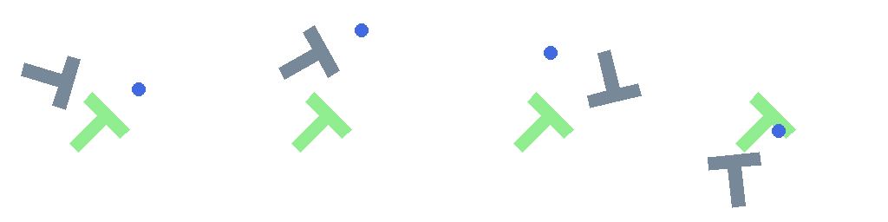
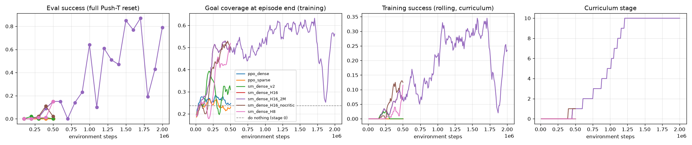

# SuperMimic on Push-T: pathwise (BPTT) vs likelihood-ratio (PPO) RL

This project applies the ideas from the **SuperMimic case study** (RL lectures I/II and
the SuperMimic paper) to the **Push-T** block-pushing task, using the task setup of
Ma et al. 2026, *A Single Diffusion-Policy Controller for Multi-Task Block Pushing*
(arXiv:2607.10892).

It targets the open question on the last slide of the case study:

> **Sparse rewards?** Manipulation and locomotion without a reference trajectory.

SuperMimic was shown on humanoid motion tracking, where the reward is **dense** (a
reference motion at every step). Push-T is the opposite: a contact-rich manipulation
task whose natural reward is **sparse** (1 only when the T covers 95% of the goal).

<p align="center"><br>
<em>Best SuperMimic policy (H = 16, 1.7M steps): blue = pusher, grey = T-block, green = goal.</em></p>

**Headline result:** the best SuperMimic checkpoint solves **87%** of 100 unseen episodes from the
original Push-T reset distribution (mean 100 steps) and **92%** at the final curriculum range.
PPO with the same observation and action space stays at 0%. Pure sparse reward fails for both
methods. See [Results](#results).

## What is implemented

| Component | File | From |
|---|---|---|
| Push-T simulator (pymunk), 95% coverage success, 300-step limit | `pusht_rl/env.py` | Push-T / Diffusion Policy |
| Objective-centric observation (block frame), velocity action in goal frame | `pusht_rl/env.py`, `pusht_rl/torch_ops.py` | ESM paper, Sec. III-B |
| Reverse curriculum: block starts within 256 ± (30 + m/M·100) px, M=10, N=50 | `pusht_rl/env.py` | ESM paper, App. B |
| Learned differentiable world model f_ω, fitted on k=8-step autoregressive windows (Eq. 1) | `pusht_rl/world_model.py` | SuperMimic Sec. 3.2 |
| Learned success/termination head, soft survival weight c_{t+1} = c_t(1 − d̂) | `pusht_rl/world_model.py` | SuperMimic Sec. 3.1 |
| Deterministic actor trained by **BPTT** through the frozen world model over H=32 steps, critic bootstrap at s_H (Eq. 2) | `pusht_rl/supermimic.py` | SuperMimic Sec. 3.3 |
| Critic fitted to λ-returns of imagined rollouts (Eq. 3) | `pusht_rl/supermimic.py` | SuperMimic Sec. 3.3 |
| Fixed-size off-policy replay buffer (old data replaced) | `pusht_rl/buffer.py` | SuperMimic |
| **PPO** baseline: clipped ratio objective + GAE | `pusht_rl/ppo.py` | RL II lecture |

### The SuperMimic loop (`train.py --algo supermimic`)

1. **Collect** – the actor plus Gaussian action noise acts in the simulator; transitions go into the replay buffer.
2. **Fit world model** – roll f_ω forward from a logged state on logged actions for k=8 steps and regress the logged states; train the success head with binary cross-entropy.
3. **Improve policy** – start from buffer states, imagine H steps with the *frozen* world model, and maximise

   J(θ) = Σ_{t<H} γ^t ĉ_t r̂_{t+1} + γ^H ĉ_H V_ψ(ŝ_H)

   by back-propagation through time. The critic V_ψ is then fitted to λ-returns of the same imagined rollout.

### Design choices for Push-T

* **World model state** (8-D): pusher position, block pose, block linear and angular velocity. The network predicts block motion **in the block frame** and rotates it back, so it does not need to relearn pushing for every position and angle.
* **Observation head** is analytic (differentiable): pusher and goal expressed in the block frame (ESM paper), plus block velocity because the Push-T block keeps sliding after a push.
* **Reward head**
  * `--reward sparse`: r̂ = P̂(success | ŝ_{t+1}) from the learned success head. The real reward is 1 on success and 0 otherwise.
  * `--reward dense`: potential-based shaping Φ(ŝ_{t+1}) − Φ(ŝ_t) + success, with Φ = exp(−d/60)·(1+cos Δθ)/2. Potential shaping keeps the optimal policy unchanged and removes any incentive to hover near the goal without finishing.
* **Success head class imbalance**: successes are rare, so each batch is 50/50 balanced and the logit is corrected by the true positive rate. This keeps the predicted termination probability calibrated.

## Setup

```bash
python -m venv .venv && source .venv/bin/activate   # or conda / uv
pip install -r requirements.txt                     # install a CUDA build of torch for GPU
python -m pytest tests -q                           # 6 quick checks
```

Linux, Windows or WSL all work; no MuJoCo or pygame is needed.

## Running

```bash
# main comparison (2M environment steps each)
python train.py --algo supermimic --reward dense  --run sm_dense
python train.py --algo supermimic --reward sparse --run sm_sparse
python train.py --algo ppo        --reward dense  --run ppo_dense
python train.py --algo ppo        --reward sparse --run ppo_sparse

# everything (also critic / horizon / curriculum ablations), then plot
bash run_experiments.sh
python plot.py                     # -> results.png
python evaluate.py runs/sm_dense   # success rate + GIFs of a saved checkpoint
```

Every run writes `runs/<name>/log.csv` (training), `eval.csv` (100 randomized test episodes,
same protocol as the ESM paper), `checkpoint.pt` and GIFs.

Useful flags: `--horizon H`, `--no-critic`, `--no-curriculum`, `--damping 0.99` (table friction,
see below), `--success-threshold 0.9`, `--policy-updates`, `--wm-updates`, `--n-envs`.

## Results

All runs: dense reward, table friction (`--damping 0.99`), seed 0, i5-9400F CPU (SuperMimic) /
RTX 4060 (PPO). Evaluation = 100 episodes from the **original Push-T reset** (block anywhere in
[100, 400]², any angle), success = 95% coverage within 300 steps.



### Main comparison at 500k environment steps

| Method | Eval success | Eval coverage | Wall-clock |
|---|---|---|---|
| Do nothing (zero action) | 0% | 0.04 | – |
| PPO, sparse reward | 0% | 0.05 | 5 min |
| PPO, dense reward | 0% | 0.06 | 5 min |
| SuperMimic, H = 32 | 0% (2% at 200k) | 0.12 | 62 min |
| SuperMimic, H = 16, **sparse reward** | 0% | 0.05 | 38 min |
| SuperMimic, H = 16 | **15%** | **0.55** | 35 min |
| SuperMimic, H = 16, seed 1 | 3% | 0.43 | 40 min |
| SuperMimic, H = 16, **no critic** | 2% (11% at 400k) | 0.36 | 28 min |
| SuperMimic, H = 8 | **15%** | 0.51 | 22 min |

### Long run: SuperMimic, H = 16, 2M steps (`sm_dense_H16_2M`)

| Steps | 0.5M | 1.0M | 1.2M | 1.5M | **1.7M** | 1.8M | 2.0M |
|---|---|---|---|---|---|---|---|
| Curriculum stage | 1 | 5 | 9 | 10 | 10 | 10 | 10 |
| Eval success | 15% | 64% | 61% | 85% | **87%** | 19% | 79% |
| Eval coverage | 0.55 | 0.81 | 0.83 | 0.88 | 0.89 | 0.50 | **0.93** |
| Mean episode length | 275 | 182 | 170 | 105 | **100** | 264 | 115 |

The curriculum finishes (stage 10, the full ±130 px range) at ~1.2M steps. The best checkpoint
reaches **87% success on the full Push-T distribution** with ~100-step episodes. The first 500k steps
are identical to `sm_dense_H16` (same seed), so training is deterministic.

### Seed variance (H = 16, dense)

| Steps | 300k | 500k | 700k | 800k | 900k |
|---|---|---|---|---|---|
| Seed 0: success / coverage / stage | 1% / 0.37 / 0 | 15% / 0.55 / 1 | 0% / 0.49 / 2 | 14% / 0.67 / 3 | 23% / 0.58 / 4 |
| Seed 1: success / coverage / stage | 3% / 0.36 / 0 | 3% / 0.43 / 1 | 11% / 0.61 / 3 | 2% / 0.40 / 3 | 0% / 0.26 / 4 |

Seed 1 was cut off at ~930k steps by a power outage. Both seeds clearly learn: they advance the
curriculum and beat PPO by a wide margin. Seed 1 is slower and noisier, so treat the 87% from seed 0
as one good run, not as the expected result.

### Findings

1. **Pathwise (BPTT) vs likelihood ratio (PPO).** With the same data budget, PPO never moves past
   the "do nothing" level (sparse: the critic loss stays ~1e-8 because no reward is ever seen, so
   advantages are pure noise). SuperMimic learns to push the T in 500k steps and to solve 87% of
   episodes in 1.7M.
2. **Horizon is the key stability knob in contact-rich tasks.** With H = 32 the actor gradient norm
   repeatedly explodes (100–3000) and learning collapses after 200k steps. With H = 16 or 8 it stays
   mostly below 5. The gradient is a product of world-model Jacobians, and contact makes them large.
   The critic covers the shorter horizon (SuperMimic Fig. 4 shows the same).
3. **The critic matters for stability.** Without it (H = 16), training curves look similar at first,
   but evaluation collapses from 11% to 2% between 400k and 500k.
4. **Physics matters.** Without table friction (original Push-T, the block keeps sliding),
   BPTT converges to "do not touch the block": every push lowers the score within the horizon.
5. **Instability remains.** Even the best run has sudden collapses (0% at 700k, 10% at 1.1M, 19% at
   1.8M) and recovers each time. Keep `checkpoint_best.pt` and run several seeds before drawing
   conclusions. Every number here is from a single seed.
6. **Pure sparse reward: SuperMimic fails just like PPO.** With `--reward sparse` (1M steps, H = 16)
   there are 0% successes, coverage stays at the do-nothing level (0.05) and the curriculum never
   leaves stage 0. Without any success, the success head learns "success never happens", so the
   imagined reward is identically 0, ∂r/∂a = 0, and the critic only learns 0. Pathwise gradients need
   *some* differentiable signal. Here it is the dense potential shaping. Even with dense shaping, the
   calibrated success head stays at `imag_success_prob` ≈ 1e-3, so the success bonus contributes little.

## Discussion: the case-study questions on Push-T

**1. Sparse rewards.** BPTT needs ∂r/∂a. With a sparse reward this derivative is zero almost
everywhere, so all the signal has to come from (a) the learned success head, which is a smooth
surrogate of the indicator function but is only informative near states where success has been
observed, and (b) the critic. The reverse curriculum is what makes the first successes possible.
Contact makes this worse: while the pusher is not touching the block, the true dynamics give
**zero** gradient from pusher motion to block pose. Only the smoothness of the learned MLP world
model and the critic V(o), which depends on where the pusher is relative to the block, can point
the pusher toward a useful contact. The case study lists "smooth gradients through contact" as
only an assumption, and this task tests it directly.

**2. How general are the world model and policy?** The replay buffer is fixed-size, so the model
mostly knows recently visited states. The curriculum shifts the state distribution over time
(block further from the goal), and the model must keep up. Logging `wm_kstep_block_err_px` over
training shows how well it does.

**3. Does the world model help the critic?** Here the critic is trained **only** on imagined
transitions (as in SuperMimic). Compare `sm_dense` with `sm_dense_nocritic` and the horizon
sweep (`sm_dense_H8`, `H16`). SuperMimic reports that without a critic, training fails at H ≤ 16.

**4. Others.** (a) *Model exploitation*: the actor can find actions that score well in imagination
but not in the simulator. Compare `J`/`imag_success_prob` with the real `train_success`.
(b) *Local optimum "do not touch"*: with a short horizon, pushing usually lowers the pose score at
first, so BPTT can converge to standing still (see results). (c) *Physics*: the original Push-T has no table
friction, so a pushed block keeps sliding. Real tabletop pushing is closer to quasi-static, which
the default `--damping 0.99` approximates. In the runs above, this single change decided whether
BPTT learned anything, which shows how sensitive pathwise gradients are to the contact dynamics.

## Layout

```
pusht_rl/env.py          Push-T simulator, curriculum, vectorised env, renderer
pusht_rl/torch_ops.py    differentiable observation / reward / world-model I/O
pusht_rl/world_model.py  f_ω dynamics + success head, k-step loss
pusht_rl/supermimic.py   BPTT actor + λ-return critic
pusht_rl/ppo.py          PPO + GAE baseline
pusht_rl/buffer.py       per-env ring replay buffer (k-step windows)
pusht_rl/evaluation.py   100-episode evaluation + GIFs
train.py / evaluate.py / plot.py / run_experiments.sh
```
